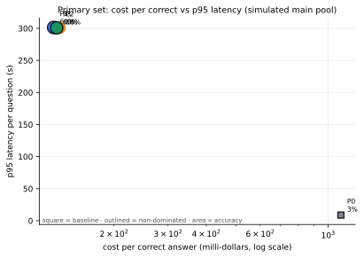
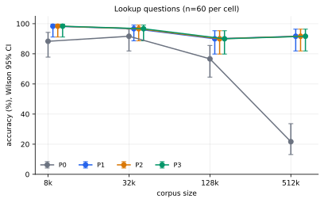
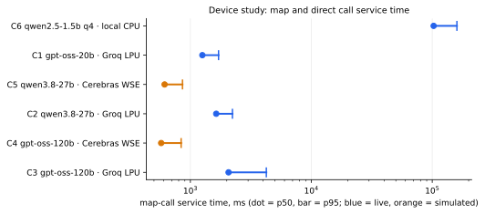

# Mosaic report

Generated by `mosaic report` from run records only (no provider calls). Every table names the run IDs its numbers come from; each run file records the git commit, config hash, data hash, seed and candidate model IDs.

Commit `6da4ba8` · data hash `98ad06dd4429c091` · seed 42 · margin 5 points · one-sided 95% paired bootstrap (10,000 resamples) · Holm across cells.

## Read this first: what is measured and what is simulated

* **Live (real API calls, real clocks):** the device study on Groq LPU (C1, C2, C3) and on this machine's CPU through llama.cpp (C6), 12 questions at 8k each, plus the planner calls (gpt-oss-120b on Groq). These numbers are measurements.
* **Simulated:** the main evaluation (720 questions × 4 pipelines) and the router training data run on the main pool C4, C5 (Cerebras) and C6, served by Mosaic's deterministic simulator in virtual time. Cerebras was not reachable from the build machine. The simulator's per-ticket error rates are **fitted from the live, oracle-labelled map calls** (same weights share one error model: C4 ← C3, C5 ← C2, C6 ← C6), its Cerebras latencies are vendor-claim-level priors, and its long-context decay for direct calls is an assumption, stated in `candidates.yaml`. So the main tables validate the machinery and show how the router behaves under those assumptions; they are not evidence about Cerebras itself.
* Re-running `mosaic report` on the same run files reproduces this file byte for byte.

## Headline: aggregate and pairwise questions at 128k and 512k

Pooled over the primary set (classes A and P, sizes 128k and 512k; runs main-P0, main-P1, main-P2, main-P3). P0 cannot read 512k (every window is about 131k tokens), so at 512k it answers from a corpus truncated to its window; that is recorded per question.

| pipeline | n | accuracy [Wilson 95%] | cost / correct | 95% CI | p50 latency | p95 latency | truncated | malformed |
|---|---|---|---|---|---|---|---|---|
| P0 direct | 240 | 3.8% [2.0%, 7.0%] | $1.0232 | [$0.6137, $2.3032] | 10.9 s | 11.0 s | 120 | 1 |
| P1 recursive, fixed | 240 | 54.2% [47.8%, 60.4%] | $0.1377 | [$0.1150, $0.1677] | 61.1 s | 241.4 s | 2 | 0 |
| P2 recursive, rules | 240 | 60.8% [54.5%, 66.8%] | $0.1254 | [$0.1067, $0.1474] | 2.5 s | 241.4 s | 2 | 0 |
| P3 recursive, learned | 240 | 61.3% [55.0%, 67.2%] | $0.1256 | [$0.1065, $0.1473] | 2.4 s | 241.4 s | 2 | 0 |

Non-dominated on (cost per correct, p95 latency, accuracy): P0, P2, P3. Baseline: P0.

## Accuracy by class and size

**Lookup (L)**

| pipeline | 8k | 32k | 128k | 512k |
|---|---|---|---|---|
| P0 | 88.3% [77.8%–94.2%] | 91.7% [81.9%–96.4%] | 76.7% [64.6%–85.6%] | 21.7% [13.1%–33.6%] |
| P1 | 98.3% [91.1%–99.7%] | 96.7% [88.6%–99.1%] | 90.0% [79.9%–95.3%] | 91.7% [81.9%–96.4%] |
| P2 | 98.3% [91.1%–99.7%] | 96.7% [88.6%–99.1%] | 90.0% [79.9%–95.3%] | 91.7% [81.9%–96.4%] |
| P3 | 98.3% [91.1%–99.7%] | 96.7% [88.6%–99.1%] | 90.0% [79.9%–95.3%] | 91.7% [81.9%–96.4%] |

**Aggregate (A)**

| pipeline | 8k | 32k | 128k | 512k |
|---|---|---|---|---|
| P0 | 76.7% [64.6%–85.6%] | 38.3% [27.1%–51.0%] | 13.3% [6.9%–24.2%] | 1.7% [0.3%–8.9%] |
| P1 | 90.0% [79.9%–95.3%] | 86.7% [75.8%–93.1%] | 58.3% [45.7%–69.9%] | 25.0% [15.8%–37.2%] |
| P2 | 90.0% [79.9%–95.3%] | 86.7% [75.8%–93.1%] | 58.3% [45.7%–69.9%] | 25.0% [15.8%–37.2%] |
| P3 | 90.0% [79.9%–95.3%] | 85.0% [73.9%–91.9%] | 56.7% [44.1%–68.4%] | 30.0% [19.9%–42.5%] |

**Pairwise (P)**

| pipeline | 8k | 32k | 128k | 512k |
|---|---|---|---|---|
| P0 | 58.3% [45.7%–69.9%] | 16.7% [9.3%–28.0%] | 0.0% [0.0%–6.0%] | 0.0% [0.0%–6.0%] |
| P1 | 96.7% [88.6%–99.1%] | 95.0% [86.3%–98.3%] | 91.7% [81.9%–96.4%] | 41.7% [30.1%–54.3%] |
| P2 | 95.0% [86.3%–98.3%] | 95.0% [86.3%–98.3%] | 93.3% [84.1%–97.4%] | 66.7% [54.1%–77.3%] |
| P3 | 95.0% [86.3%–98.3%] | 95.0% [86.3%–98.3%] | 91.7% [81.9%–96.4%] | 66.7% [54.1%–77.3%] |

## Paired comparisons and non-inferiority verdicts

Verdict wording is fixed in advance: non-inferior = "No worse than the baseline within 5.0 points"; superior = "Better than the baseline"; inferior = "Worse than the baseline"; inconclusive = "Not resolved by this sample" (never "equal"). Differences are B − A in accuracy points. The primary analysis is pooled; the per-cell rows (60 questions each) are exploratory and Holm-adjusted.

### P1 vs P0: Does recursion alone help?

Runs: A = `main-P0`, B = `main-P1`.

| cell | n | acc P0 | acc P1 | diff | one-sided 95% CI | McNemar p (Holm) | verdict |
|---|---|---|---|---|---|---|---|
| **A+P 128k+512k** | 240 | 3.8% | 54.2% | +50.4 | [+44.6, +56.2] | 1.32e-30 | superior |
| A 8k | 60 | 76.7% | 90.0% | +13.3 | [+3.3, +23.3] | 0.23 | superior |
| A 32k | 60 | 38.3% | 86.7% | +48.3 | [+35.0, +61.7] | 7.59e-06 | superior |
| A 128k | 60 | 13.3% | 58.3% | +45.0 | [+31.7, +58.3] | 4.46e-05 | superior |
| A 512k | 60 | 1.7% | 25.0% | +23.3 | [+13.3, +33.3] | 0.00259 | superior |
| L 8k | 60 | 88.3% | 98.3% | +10.0 | [+3.3, +16.7] | 0.125 | superior |
| L 32k | 60 | 91.7% | 96.7% | +5.0 | [+0.0, +11.7] | 0.375 | non-inferior |
| L 128k | 60 | 76.7% | 90.0% | +13.3 | [+3.3, +23.3] | 0.23 | superior |
| L 512k | 60 | 21.7% | 91.7% | +70.0 | [+60.0, +80.0] | 4.55e-12 | superior |
| P 8k | 60 | 58.3% | 96.7% | +38.3 | [+28.3, +48.3] | 1.91e-06 | superior |
| P 32k | 60 | 16.7% | 95.0% | +78.3 | [+68.3, +86.7] | 1.95e-12 | superior |
| P 128k | 60 | 0.0% | 91.7% | +91.7 | [+85.0, +96.7] | 6.66e-16 | superior |
| P 512k | 60 | 0.0% | 41.7% | +41.7 | [+31.7, +51.7] | 5.36e-07 | superior |

### P2 vs P1: Does routing save cost without losing quality?

Runs: A = `main-P1`, B = `main-P2`.

| cell | n | acc P1 | acc P2 | diff | one-sided 95% CI | McNemar p (Holm) | verdict |
|---|---|---|---|---|---|---|---|
| **A+P 128k+512k** | 240 | 54.2% | 60.8% | +6.7 | [+2.9, +10.4] | 0.007 | superior |
| A 8k | 60 | 90.0% | 90.0% | +0.0 | [+0.0, +0.0] | 1 | non-inferior |
| A 32k | 60 | 86.7% | 86.7% | +0.0 | [+0.0, +0.0] | 1 | non-inferior |
| A 128k | 60 | 58.3% | 58.3% | +0.0 | [-5.0, +5.0] | 1 | inconclusive |
| A 512k | 60 | 25.0% | 25.0% | +0.0 | [-5.0, +5.0] | 1 | inconclusive |
| L 8k | 60 | 98.3% | 98.3% | +0.0 | [+0.0, +0.0] | 1 | non-inferior |
| L 32k | 60 | 96.7% | 96.7% | +0.0 | [+0.0, +0.0] | 1 | non-inferior |
| L 128k | 60 | 90.0% | 90.0% | +0.0 | [+0.0, +0.0] | 1 | non-inferior |
| L 512k | 60 | 91.7% | 91.7% | +0.0 | [+0.0, +0.0] | 1 | non-inferior |
| P 8k | 60 | 96.7% | 95.0% | -1.7 | [-5.0, +0.0] | 1 | inconclusive |
| P 32k | 60 | 95.0% | 95.0% | +0.0 | [+0.0, +0.0] | 1 | non-inferior |
| P 128k | 60 | 91.7% | 93.3% | +1.7 | [+0.0, +5.0] | 1 | non-inferior |
| P 512k | 60 | 41.7% | 66.7% | +25.0 | [+13.3, +36.7] | 0.0312 | superior |

### P3 vs P2: Does learning beat rules?

Runs: A = `main-P2`, B = `main-P3`.

| cell | n | acc P2 | acc P3 | diff | one-sided 95% CI | McNemar p (Holm) | verdict |
|---|---|---|---|---|---|---|---|
| **A+P 128k+512k** | 240 | 60.8% | 61.3% | +0.4 | [-3.3, +4.2] | 1 | non-inferior |
| A 8k | 60 | 90.0% | 90.0% | +0.0 | [+0.0, +0.0] | 1 | non-inferior |
| A 32k | 60 | 86.7% | 85.0% | -1.7 | [-8.3, +5.0] | 1 | inconclusive |
| A 128k | 60 | 58.3% | 56.7% | -1.7 | [-11.7, +8.3] | 1 | inconclusive |
| A 512k | 60 | 25.0% | 30.0% | +5.0 | [-6.7, +16.7] | 1 | inconclusive |
| L 8k | 60 | 98.3% | 98.3% | +0.0 | [+0.0, +0.0] | 1 | non-inferior |
| L 32k | 60 | 96.7% | 96.7% | +0.0 | [+0.0, +0.0] | 1 | non-inferior |
| L 128k | 60 | 90.0% | 90.0% | +0.0 | [+0.0, +0.0] | 1 | non-inferior |
| L 512k | 60 | 91.7% | 91.7% | +0.0 | [+0.0, +0.0] | 1 | non-inferior |
| P 8k | 60 | 95.0% | 95.0% | +0.0 | [+0.0, +0.0] | 1 | non-inferior |
| P 32k | 60 | 95.0% | 95.0% | +0.0 | [+0.0, +0.0] | 1 | non-inferior |
| P 128k | 60 | 93.3% | 91.7% | -1.7 | [-5.0, +0.0] | 1 | inconclusive |
| P 512k | 60 | 66.7% | 66.7% | +0.0 | [+0.0, +0.0] | 1 | non-inferior |

### P3 vs P0: Primary claim: learned recursion vs the baseline

Runs: A = `main-P0`, B = `main-P3`.

| cell | n | acc P0 | acc P3 | diff | one-sided 95% CI | McNemar p (Holm) | verdict |
|---|---|---|---|---|---|---|---|
| **A+P 128k+512k** | 240 | 3.8% | 61.3% | +57.5 | [+51.7, +63.3] | 2.09e-35 | superior |
| A 8k | 60 | 76.7% | 90.0% | +13.3 | [+3.3, +23.3] | 0.23 | superior |
| A 32k | 60 | 38.3% | 85.0% | +46.7 | [+33.3, +60.0] | 2.98e-05 | superior |
| A 128k | 60 | 13.3% | 56.7% | +43.3 | [+30.0, +56.7] | 0.000122 | superior |
| A 512k | 60 | 1.7% | 30.0% | +28.3 | [+18.3, +38.3] | 9.16e-05 | superior |
| L 8k | 60 | 88.3% | 98.3% | +10.0 | [+3.3, +16.7] | 0.125 | superior |
| L 32k | 60 | 91.7% | 96.7% | +5.0 | [+0.0, +11.7] | 0.375 | non-inferior |
| L 128k | 60 | 76.7% | 90.0% | +13.3 | [+3.3, +23.3] | 0.23 | superior |
| L 512k | 60 | 21.7% | 91.7% | +70.0 | [+60.0, +80.0] | 4.55e-12 | superior |
| P 8k | 60 | 58.3% | 95.0% | +36.7 | [+25.0, +48.3] | 2.38e-05 | superior |
| P 32k | 60 | 16.7% | 95.0% | +78.3 | [+68.3, +86.7] | 1.95e-12 | superior |
| P 128k | 60 | 0.0% | 91.7% | +91.7 | [+85.0, +96.7] | 6.66e-16 | superior |
| P 512k | 60 | 0.0% | 66.7% | +66.7 | [+56.7, +76.7] | 1.64e-11 | superior |

## Sample size: the honest arithmetic

On the primary set 240 questions are paired and 62.5% of pairs disagree, so the CI half-width is about ±10.0 points (1.96·√(p_disc/n)). A 2-point margin would need about 6,003 paired questions at this discordance, and a 5-point margin about 961. The PRD expected ~10% discordance; here the baseline fails so often at 128k+ that discordance is far higher, which is why the verdict is decisive despite the wide interval.

## Cost per correct answer and p95 latency per cell

Cost is measured tokens × configured list prices (free-tier calls priced at list price); CPU calls are priced as electricity plus amortisation. Latency is the critical path per question (plan + filter + slowest map wave + reduce), computed from spans. In virtual time the simulated user asks the next question a minute after each answer, so rate-limit queueing within a question is real but backlog across questions is not.

| cell | P0: $/correct · p95 | P1: $/correct · p95 | P2: $/correct · p95 | P3: $/correct · p95 |
|---|---|---|---|---|
| L 8k | $0.00283 · 1.0s | $0.00077 · 0.8s | $0.00079 · 0.8s | $0.00079 · 0.8s |
| L 32k | $0.0105 · 3.0s | $0.00135 · 3.2s | $0.00136 · 3.2s | $0.00136 · 3.2s |
| L 128k | $0.0498 · 10.9s | $0.00359 · 11.1s | $0.00359 · 11.1s | $0.00359 · 11.1s |
| L 512k | $0.1781 · 11.1s | $0.00146 · 0.8s | $0.00146 · 0.8s | $0.00146 · 0.8s |
| A 8k | $0.00326 · 1.0s | $0.00154 · 1.2s | $0.00155 · 1.2s | $0.00158 · 1.2s |
| A 32k | $0.0251 · 3.0s | $0.00273 · 1.3s | $0.00273 · 1.3s | $0.00294 · 1.3s |
| A 128k | $0.2861 · 11.0s | $0.0176 · 2.4s | $0.0181 · 2.4s | $0.0194 · 2.3s |
| A 512k | $2.3148 · 11.1s | $0.1741 · 181.2s | $0.1775 · 135.8s | $0.1533 · 301.0s |
| P 8k | $0.00429 · 1.0s | $0.00380 · 1.7s | $0.00388 · 1.8s | $0.00390 · 1.8s |
| P 32k | $0.0578 · 3.0s | $0.0135 · 1.3s | $0.0136 · 1.3s | $0.0136 · 1.4s |
| P 128k | — · 10.9s | $0.0547 · 61.3s | $0.0551 · 11.2s | $0.0561 · 11.2s |
| P 512k | — · 11.0s | $0.4665 · 241.5s | $0.2981 · 241.4s | $0.2991 · 241.4s |

## Router diagnostics (P3, learned)

Calls per role and candidate (successful calls; run `main-P3`):

| role | C4 | C5 | C6 | total |
|---|---|---|---|---|
| direct | 11 | 239 | 0 | 250 |
| mapper | 1339 | 14905 | 81 | 16325 |
| planner | 2 | 721 | 0 | 723 |

For contrast, P2 mapper calls: C4 768 (4.7%), C5 15482 (94.8%), C6 79 (0.5%).

For contrast, P1 mapper calls: C5 16186 (100.0%).

1517 mapper calls (9.3%) had no candidate above the bar and were flagged; 51 failed calls fell back to the next candidate.

Predicted vs realised quality on evaluation map calls (not used for training): mean predicted 0.939, observed 0.940, Brier 0.0527 vs constant 0.0567.

Predicted vs realised mapper latency: median realised/predicted = 1.00; cost: 0.93 (realised/predicted, total).

### Predictor calibration (held-out profiling data)

One logistic regression per (role, candidate) on profiling labels (separate questions and corpora from the evaluation). Isotonic scaling is applied only when the held-out gap is large and it lowers Brier.

| role|candidate | model | n train | n test | base rate | Brier | Brier const | beats const | calibration | max bin gap (pts) |
|---|---|---|---|---|---|---|---|---|---|
| direct|C1 | constant | 3 | 1 | 1.000 | 0.0000 | 0.0000 | **no** | none | 0.0 |
| direct|C2 | constant | 3 | 1 | 1.000 | 0.0000 | 0.0000 | **no** | none | 0.0 |
| direct|C3 | constant | 3 | 1 | 1.000 | 0.0000 | 0.0000 | **no** | none | 0.0 |
| direct|C4 | constant | 26 | 10 | 1.000 | 0.0000 | 0.0000 | **no** | none | 0.0 |
| direct|C5 | logistic | 70 | 30 | 0.950 | 0.0054 | 0.0051 | **no** | none | 5.6 |
| direct|C6 | logistic | 73 | 31 | 0.798 | 0.1322 | 0.1386 | yes | none | 18.5 |
| mapper|C1 | constant | 13 | 5 | 0.889 | 0.1751 | 0.1751 | **no** | none | 0.0 |
| mapper|C2 | constant | 13 | 5 | 1.000 | 0.0000 | 0.0000 | **no** | none | 0.0 |
| mapper|C3 | constant | 13 | 5 | 0.944 | 0.0059 | 0.0059 | **no** | none | 0.0 |
| mapper|C4 | logistic | 1477 | 632 | 0.810 | 0.1430 | 0.1424 | **no** | none | 8.0 |
| mapper|C5 | logistic | 5047 | 2162 | 0.945 | 0.0445 | 0.0443 | **no** | none | 20.6 |
| mapper|C6 | logistic | 5059 | 2168 | 0.015 | 0.0110 | 0.0154 | yes | none | 8.7 |
| planner|C4 | constant | 70 | 30 | 0.960 | 0.0033 | 0.0033 | **no** | none | 5.7 |
| planner|C5 | constant | 210 | 90 | 0.937 | 0.0526 | 0.0526 | **no** | none | 1.1 |

Standardised coefficients (positive = more likely correct):

| feature | direct|C5 | direct|C6 | mapper|C4 | mapper|C5 | mapper|C6 |
|---|---|---|---|---|---|
| cue_share | +0.00 | +0.00 | +0.16 | -0.45 | -0.52 |
| has_amount | +0.00 | +0.00 | +0.05 | -0.10 | -0.57 |
| has_bool | +0.00 | +0.00 | +0.08 | -0.07 | +0.33 |
| has_category | +0.00 | +0.00 | -0.06 | +0.27 | -0.08 |
| has_sentiment | +0.00 | +0.00 | +0.02 | -0.27 | +1.33 |
| log_tokens | -0.53 | -0.38 | -0.01 | -0.32 | +0.11 |
| money_share | +0.00 | +0.00 | -0.18 | +0.15 | +0.84 |
| n_fields | +0.00 | +0.00 | +0.05 | -0.10 | +0.65 |
| n_tickets | +0.00 | +0.00 | -0.10 | -0.04 | -0.45 |
| pair | +0.00 | +0.00 | -0.05 | +0.04 | -0.07 |
| semantic | +0.00 | +0.00 | +0.00 | +0.00 | +0.00 |
| uncued_money | +0.00 | +0.00 | +0.45 | -0.30 | -1.01 |

### Exploration, and what it costs

The evaluation run `main-P3` is the learned policy with exploration off. A second run, `main-P3x`, sends 5% of calls to a random feasible candidate and logs the propensity. Exploring cost 2.1 accuracy points overall (82.2% → 80.1%; 21 questions flipped from right to wrong): one question fans out into up to ~180 map calls, so per-call exploration almost always touches some call of a large question, and one bad chunk breaks an exact answer. Exploration belongs on a profiling stream or under a per-question budget, not on every call.

Inverse-propensity estimates of how fixed mapper policies would have done on the logged calls of `main-P3x`, without re-running them:

| policy | matching calls | estimated map-call accuracy | note |
|---|---|---|---|
| logged policy (P3) | 16327 | 92.5% | direct average |
| always C5 | 14598 | 90.6% | IPS |
| always C4 | 1492 | 70.3% | IPS |
| always C6 | 237 | 0.0% | IPS |

## Lookups: does the system take the direct path? (M4)

| pipeline | lookups | direct strategy | direct + filter isolating the ticket | accuracy |
|---|---|---|---|---|
| P1 | 240 | 100.0% | 95.4% | 94.2% |
| P2 | 240 | 100.0% | 95.4% | 94.2% |
| P3 | 240 | 100.0% | 95.4% | 94.2% |

The planner (shared by P1–P3) decides the strategy; the router then places the single direct call.

## Device study: same weights, different silicon

P1 (every executor call on one candidate) on the same 12 questions at 8k (4 per class), with the same plans (written once by gpt-oss-120b on Groq and replayed from the cache). Service time = time from admission to last token; queue = time waiting for the free-tier token budget.

| id | weights | device | source | questions | accuracy | map calls fully correct | TTFT p50/p95 ms | service p50/p95 ms | decode tok/s | mean queue | reasoning share of output |
|---|---|---|---|---|---|---|---|---|---|---|---|
| C3 | gpt-oss-120b | Groq LPU | live | 12 | 83.3% | 94% of 18 | 583 / 1945 | 2069 / 4246 | 477 | 31.0 s | 55.6% |
| C4 | gpt-oss-120b | Cerebras WSE | simulated | 12 | 91.7% | 83% of 18 | 419 / 688 | 573 / 838 | 2595 | 0.0 s | 37.8% |
| C2 | qwen3.8-27b | Groq LPU | live | 12 | 91.7% | 100% of 18 | 1635 / 2226 | 1635 / 2227 | 391 (fit, buffered) | 25.4 s | 0.0% |
| C5 | qwen3.8-27b | Cerebras WSE | simulated | 12 | 91.7% | 94% of 18 | 441 / 664 | 612 / 860 | 1646 | 0.0 s | 0.0% |
| C1 | gpt-oss-20b | Groq LPU | live | 12 | 83.3% | 89% of 18 | 701 / 842 | 1256 / 1710 | 936 | 61.5 s | 50.9% |
| C6 | qwen2.5-1.5b q4 | local CPU | live | 12 | 41.7% | 6% of 18 | 29003 / 39585 | 102741 / 160008 | 5 | 71.4 s | 0.0% |

Decode speed is the median of output tokens over (service time − TTFT) per call. *Buffered*: the provider sent the whole JSON answer in one chunk (Groq's Qwen in JSON mode), so TTFT equals service time and the speed is instead fitted from service time against input and output tokens across the run's calls.

Runs: `device-C3-live`, `device-C4-sim`, `device-C2-live`, `device-C5-sim`, `device-C1-live`, `device-C6-live`. With 12 questions the accuracy columns are anecdotal; the latency rows rest on every call in the run. The Cerebras rows are simulated from priors, so the same-weights comparison (C3 vs C4, C2 vs C5) is only half measured: a key with Cerebras access turns them into measurements with `mosaic run --pipeline P1 --sizes 8k --n-per-class 4 --fixed C4 --planner C3 --live C4,C3`.

## Simulator error model (fitted from live calls)

Per-ticket, per-field error rates the simulator uses, normalised by its context-rot factor (1 + chunk tokens / 6000). Fitted by `mosaic calibrate` from the live device runs as posterior means under a Beta prior worth 50 observations, counting each distinct call once; n = ticket-field observations behind each rate. Thin rows (sentiment: 3 observations) stay near the prior. Live errors were systematic per phrasing (the same template misread every time), which an independent per-ticket model understates.

| id | weights | source | category | refund flag and amount | sentiment | dropped row | malformed call |
|---|---|---|---|---|---|---|---|
| C1 | gpt-oss-20b | fitted | 0.0126 (n=206) | 0.0087 (n=68) | 0.0471 (n=3) | 0.0004 (n=283) | 0.0077 (n=15) |
| C2 | qwen3.8-27b | fitted | 0.0021 (n=206) | 0.0044 (n=68) | 0.0099 (n=3) | 0.0003 (n=283) | 0.0046 (n=15) |
| C3 | gpt-oss-120b | fitted | 0.0100 (n=206) | 0.0030 (n=68) | 0.0066 (n=3) | 0.0001 (n=283) | 0.0031 (n=15) |
| C4 | gpt-oss-120b | fitted | 0.0100 (n=206) | 0.0030 (n=68) | 0.0066 (n=3) | 0.0001 (n=283) | 0.0031 (n=15) |
| C5 | qwen3.8-27b | fitted | 0.0021 (n=206) | 0.0044 (n=68) | 0.0099 (n=3) | 0.0003 (n=283) | 0.0046 (n=15) |
| C6 | qwen2.5-1.5b-q4 | fitted | 0.3897 (n=205) | 0.2448 (n=66) | — | 0.0052 (n=280) | 0.0615 (n=15) |

Latency profiles used by the router (`profiles/profiles.parquet`):

| candidate | concurrency | source | TTFT p50 | TTFT p95 | TTFT base | prefill tok/s | decode tok/s | error rate | calls |
|---|---|---|---|---|---|---|---|---|---|
| C1 | 1 | live:device-C1-live | 701 | 842 | 368 | 3366 | 4097 | 0.000 | 22 |
| C2 | 1 | live:device-C2-live | 1635 | 2226 | 343 | 39207 | 391 | 0.000 | 22 |
| C3 | 1 | live:device-C3-live | 583 | 1527 | 324 | 4803 | 429 | 0.000 | 34 |
| C4 | 1 | sim | 471 | 588 | 245 | 15074 | 2292 | 0.004 | 2153 |
| C4 | 4 | sim | 471 | 588 | 245 | 15074 | 2292 | 0.004 | 2153 |
| C5 | 1 | sim | 493 | 602 | 232 | 11144 | 1895 | 0.003 | 7333 |
| C5 | 16 | sim | 493 | 602 | 232 | 11144 | 1895 | 0.003 | 7333 |
| C6 | 1 | live:device-C6-live | 29003 | 39585 | 0 | 141 | 5 | 0.000 | 22 |
| C6 | 1 | sim | 22903 | 23343 | 90 | 142 | 5 | 0.001 | 7318 |

## Success metrics (hypotheses, reported whichever way they land)

M1–M5 use the simulated main pool (see the first section).

| metric | target | result | status |
|---|---|---|---|
| M1 accuracy, A+P at 128k+ | non-inferior, 5-point margin | diff +57.5, CI low +51.7 → superior | met |
| M2 cost per correct | ≤ 1/3 of baseline | $0.1256 vs $1.0232 (0.12×) | met |
| M3 p95 latency | no worse than baseline | 241.4 s vs 11.0 s | not met |
| M4 direct path on lookups | ≥ 90% | 100.0% | met |
| M5 calibration | Brier < constant; bins within 10 pts | 2/5 beat constant; worst bin gap 20.6 pts | not met |
| M6 reproducibility | cached re-run reproduces every number | 3672/3672 question records reproduced exactly across 11 runs (live runs replayed offline); report rebuilt byte-identical: True | met |
| M7 code size and tests | < ~2,500 core lines; ≥ 80% coverage on core | 1,690 core lines; 94% coverage; 99 tests | met |

## Limitations

* Cerebras (C4, C5) was unreachable from the build machine, so every main-pool Cerebras call is simulated. The error model is fitted from Groq calls with the same weights; latency and quota behaviour come from published limits and vendor-level speed claims.
* The direct path's degradation with context length in the simulator is an assumption (it follows the pattern RLM and OOLONG report: lookups stay easy, aggregation collapses), not a measurement. Groq's free plan caps a call at 8k tokens, so it could not measure direct reads of 32k+ corpora.
* The device study is 12 questions per device because Groq's free plan allows 200k tokens a day per model.
* Latency repeats and the noise floor: the simulator is deterministic, so three repeats or a second P0 run would reproduce the same numbers (0 noise by construction); the live device study is a single pass under quota, and P0 can't run live on Groq's free plan because the corpus exceeds its 8k-token-per-call cap. Live run-to-run noise is therefore unmeasured.
* M3 is not met for a physical reason under these quotas: recursion reads the whole 512k corpus (4× what P0 can even see) and C5 admits 150k tokens a minute, so a full-corpus pairwise question needs about four minutes of quota however it is routed.
* Cloud energy is not measurable from outside and is not reported. Local CPU energy needs RAPL or powermetrics counters, which the build container does not expose, so it is omitted rather than estimated; the CPU cost uses the nominal 28 W in `mosaic.yaml`.
* Network jitter beyond the measured p95, provider-side batching and price changes during a run are not modelled. Prices are list prices typed into `candidates.yaml`; the Qwen 3.8 27B Cerebras price is a placeholder.
* Mosaic is an independent reconstruction from public material and makes no claim about Callosum's internals.

