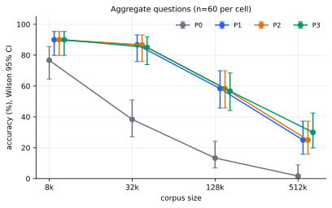
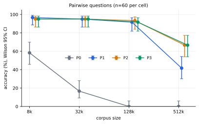
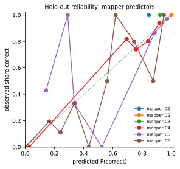

# Mosaic report

Generated by `mosaic report` from run records only (no provider calls). Every table names the run IDs its numbers come from; each run file records the git commit, config hash, data hash, seed and candidate model IDs.

Commit `6499617` · data hash `98ad06dd4429c091` · seed 42 · margin 5 points · one-sided 95% paired bootstrap (10,000 resamples) · Holm across cells.

## Read this first: what is measured and what is simulated

* **Live (real API calls, real clocks):** the device study, 12 questions at 8k on every candidate: Groq LPU (C1, C2, C3), Cerebras wafer-scale (C4, C5) and this machine's CPU through llama.cpp (C6), with plans written by gpt-oss-120b on Groq. Then a live validation slice on the Cerebras main pool: P0, P0f and P3 on 20 aggregate and pairwise questions at 128k (section *Live validation*). These numbers are measurements.
* **Simulated:** the full main evaluation (720 questions × 5 pipelines) and the router's training data, on the main pool C4, C5 (Cerebras) and C6, served by Mosaic's deterministic simulator in virtual time. Running it live would take about 15 hours of Cerebras quota per pipeline. The simulator's per-ticket error rates are **fitted from the live, oracle-labelled map calls of all six devices** (each set of weights shares one error model, fitted from both of its devices), and its latencies are the **measured** live profiles. Its long-context decay for direct calls remains an assumption, stated in `candidates.yaml`. The live validation slice checks the simulator against reality on the same questions.
* Re-running `mosaic report` on the same run files reproduces this file byte for byte.

## Headline: aggregate and pairwise questions at 128k and 512k

Pooled over the primary set (classes A and P, sizes 128k and 512k, 240 questions; runs main-P0, main-P0f, main-P1, main-P2, main-P3).

**P0 is not "one model reading everything".** Every window is about 131k tokens and real tokenizers count about 13% more than Mosaic's estimate, so P0 had to trim the corpus on 240 of the 240 primary questions, 128k included: it reads the first 84% of a 128k log and the first 21% of a 512k one. Read P0 as *one model reading as much of the log as fits*. P0f is the stronger baseline: it applies the same plan's filter in code and then makes a single direct call over what is left, so P0 → P0f measures filtering, and P0f → P1 measures splitting the work into per-chunk extraction plus reducing in code.

| pipeline | n | accuracy [Wilson 95%] | cost / correct | 95% CI | p50 latency | p95 latency | truncated | malformed |
|---|---|---|---|---|---|---|---|---|
| P0 one direct call, corpus trimmed to the window | 240 | 2.9% [1.4%, 5.9%] | $1.1007 | [$0.5927, $3.8523] | 8.6 s | 8.8 s | 240 | 0 |
| P0f filter in code, then one direct call | 240 | 25.0% [19.9%, 30.8%] | $0.0884 | [$0.0679, $0.1171] | 9.0 s | 9.3 s | 136 | 0 |
| P1 recursive, fixed | 240 | 60.0% [53.7%, 66.0%] | $0.1270 | [$0.1074, $0.1507] | 61.5 s | 301.4 s | 1 | 0 |
| P2 recursive, rules | 240 | 57.9% [51.6%, 64.0%] | $0.1329 | [$0.1128, $0.1572] | 61.5 s | 300.8 s | 1 | 0 |
| P3 recursive, learned | 240 | 59.6% [53.3%, 65.6%] | $0.1299 | [$0.1108, $0.1531] | 61.5 s | 300.8 s | 1 | 0 |

Non-dominated on (cost per correct, p95 latency, accuracy): P0, P0f, P1, P3. Baseline: P0.

## Accuracy by class and size

**Lookup (L)**

| pipeline | 8k | 32k | 128k | 512k |
|---|---|---|---|---|
| P0 | 91.7% [81.9%–96.4%] | 81.7% [70.1%–89.4%] | 63.3% [50.7%–74.4%] | 15.0% [8.1%–26.1%] |
| P0f | 96.7% [88.6%–99.1%] | 100.0% [94.0%–100.0%] | 95.0% [86.3%–98.3%] | 85.0% [73.9%–91.9%] |
| P1 | 96.7% [88.6%–99.1%] | 100.0% [94.0%–100.0%] | 95.0% [86.3%–98.3%] | 85.0% [73.9%–91.9%] |
| P2 | 96.7% [88.6%–99.1%] | 100.0% [94.0%–100.0%] | 95.0% [86.3%–98.3%] | 86.7% [75.8%–93.1%] |
| P3 | 96.7% [88.6%–99.1%] | 100.0% [94.0%–100.0%] | 95.0% [86.3%–98.3%] | 86.7% [75.8%–93.1%] |

**Aggregate (A)**

| pipeline | 8k | 32k | 128k | 512k |
|---|---|---|---|---|
| P0 | 78.3% [66.4%–86.9%] | 31.7% [21.3%–44.2%] | 5.0% [1.7%–13.7%] | 1.7% [0.3%–8.9%] |
| P0f | 90.0% [79.9%–95.3%] | 86.7% [75.8%–93.1%] | 60.0% [47.4%–71.4%] | 35.0% [24.2%–47.6%] |
| P1 | 86.7% [75.8%–93.1%] | 66.7% [54.1%–77.3%] | 51.7% [39.3%–63.8%] | 36.7% [25.6%–49.3%] |
| P2 | 88.3% [77.8%–94.2%] | 66.7% [54.1%–77.3%] | 51.7% [39.3%–63.8%] | 38.3% [27.1%–51.0%] |
| P3 | 86.7% [75.8%–93.1%] | 66.7% [54.1%–77.3%] | 51.7% [39.3%–63.8%] | 38.3% [27.1%–51.0%] |

**Pairwise (P)**

| pipeline | 8k | 32k | 128k | 512k |
|---|---|---|---|---|
| P0 | 41.7% [30.1%–54.3%] | 10.0% [4.7%–20.1%] | 5.0% [1.7%–13.7%] | 0.0% [0.0%–6.0%] |
| P0f | 36.7% [25.6%–49.3%] | 8.3% [3.6%–18.1%] | 5.0% [1.7%–13.7%] | 0.0% [0.0%–6.0%] |
| P1 | 95.0% [86.3%–98.3%] | 95.0% [86.3%–98.3%] | 91.7% [81.9%–96.4%] | 60.0% [47.4%–71.4%] |
| P2 | 95.0% [86.3%–98.3%] | 95.0% [86.3%–98.3%] | 76.7% [64.6%–85.6%] | 65.0% [52.4%–75.8%] |
| P3 | 95.0% [86.3%–98.3%] | 95.0% [86.3%–98.3%] | 76.7% [64.6%–85.6%] | 71.7% [59.2%–81.5%] |

## Paired comparisons and non-inferiority verdicts

Verdict wording is fixed in advance: non-inferior = "No worse than the baseline within 5.0 points"; superior = "Better than the baseline"; inferior = "Worse than the baseline"; inconclusive = "Not resolved by this sample" (never "equal"). Differences are B − A in accuracy points.

The pooled row (in bold) is the analysis fixed in advance; it is a single test per comparison, so its one-sided 95% CI and verdict need no multiplicity correction. The per-cell rows (60 questions each) are exploratory: their McNemar p-values are Holm-adjusted across the cells, but their CIs, and so their verdicts, are **unadjusted** 95% intervals, and are labelled that way. With 12 cells, an unadjusted "superior" or "inferior" cell should be read as a lead, not a finding.

### P1 vs P0: Does recursion alone help?

Runs: A = `main-P0`, B = `main-P1`.

| cell | n | acc P0 | acc P1 | diff | one-sided 95% CI | McNemar p (Holm) | verdict |
|---|---|---|---|---|---|---|---|
| **A+P 128k+512k** | 240 | 2.9% | 60.0% | +57.1 | [+51.7, +62.1] | 4.02e-40 | **superior** |
| A 8k | 60 | 78.3% | 86.7% | +8.3 | [-3.3, +20.0] | 0.665 | non-inferior (unadjusted) |
| A 32k | 60 | 31.7% | 66.7% | +35.0 | [+21.7, +48.3] | 0.000769 | superior (unadjusted) |
| A 128k | 60 | 5.0% | 51.7% | +46.7 | [+35.0, +58.3] | 4.62e-07 | superior (unadjusted) |
| A 512k | 60 | 1.7% | 36.7% | +35.0 | [+25.0, +45.0] | 5.72e-06 | superior (unadjusted) |
| L 8k | 60 | 91.7% | 96.7% | +5.0 | [-1.7, +11.7] | 0.665 | non-inferior (unadjusted) |
| L 32k | 60 | 81.7% | 100.0% | +18.3 | [+10.0, +26.7] | 0.00293 | superior (unadjusted) |
| L 128k | 60 | 63.3% | 95.0% | +31.7 | [+20.0, +43.3] | 0.00033 | superior (unadjusted) |
| L 512k | 60 | 15.0% | 85.0% | +70.0 | [+58.3, +80.0] | 2.91e-10 | superior (unadjusted) |
| P 8k | 60 | 41.7% | 95.0% | +53.3 | [+40.0, +65.0] | 4.67e-07 | superior (unadjusted) |
| P 32k | 60 | 10.0% | 95.0% | +85.0 | [+76.7, +93.3] | 1.32e-13 | superior (unadjusted) |
| P 128k | 60 | 5.0% | 91.7% | +86.7 | [+80.0, +93.3] | 5.33e-15 | superior (unadjusted) |
| P 512k | 60 | 0.0% | 60.0% | +60.0 | [+50.0, +70.0] | 2.91e-10 | superior (unadjusted) |

### P0f vs P0: Does filtering in code alone help?

Runs: A = `main-P0`, B = `main-P0f`.

| cell | n | acc P0 | acc P0f | diff | one-sided 95% CI | McNemar p (Holm) | verdict |
|---|---|---|---|---|---|---|---|
| **A+P 128k+512k** | 240 | 2.9% | 25.0% | +22.1 | [+17.5, +26.7] | 3.11e-15 | **superior** |
| A 8k | 60 | 78.3% | 90.0% | +11.7 | [+1.7, +21.7] | 0.711 | superior (unadjusted) |
| A 32k | 60 | 31.7% | 86.7% | +55.0 | [+43.3, +66.7] | 1.02e-07 | superior (unadjusted) |
| A 128k | 60 | 5.0% | 60.0% | +55.0 | [+43.3, +66.7] | 2.31e-08 | superior (unadjusted) |
| A 512k | 60 | 1.7% | 35.0% | +33.3 | [+23.3, +43.3] | 1.72e-05 | superior (unadjusted) |
| L 8k | 60 | 91.7% | 96.7% | +5.0 | [-1.7, +11.7] | 1 | non-inferior (unadjusted) |
| L 32k | 60 | 81.7% | 100.0% | +18.3 | [+10.0, +26.7] | 0.00684 | superior (unadjusted) |
| L 128k | 60 | 63.3% | 95.0% | +31.7 | [+20.0, +43.3] | 0.000528 | superior (unadjusted) |
| L 512k | 60 | 15.0% | 85.0% | +70.0 | [+58.3, +80.0] | 3.69e-10 | superior (unadjusted) |
| P 8k | 60 | 41.7% | 36.7% | -5.0 | [-10.0, -1.7] | 1 | inconclusive (unadjusted) |
| P 32k | 60 | 10.0% | 8.3% | -1.7 | [-5.0, +0.0] | 1 | inconclusive (unadjusted) |
| P 128k | 60 | 5.0% | 5.0% | +0.0 | [+0.0, +0.0] | 1 | non-inferior (unadjusted) |
| P 512k | 60 | 0.0% | 0.0% | +0.0 | [+0.0, +0.0] | 1 | non-inferior (unadjusted) |

### P1 vs P0f: Does splitting the work help beyond filtering?

Runs: A = `main-P0f`, B = `main-P1`.

| cell | n | acc P0f | acc P1 | diff | one-sided 95% CI | McNemar p (Holm) | verdict |
|---|---|---|---|---|---|---|---|
| **A+P 128k+512k** | 240 | 25.0% | 60.0% | +35.0 | [+27.9, +42.1] | 2.71e-13 | **superior** |
| A 8k | 60 | 90.0% | 86.7% | -3.3 | [-11.7, +3.3] | 1 | inconclusive (unadjusted) |
| A 32k | 60 | 86.7% | 66.7% | -20.0 | [-31.7, -8.3] | 0.0945 | inferior (unadjusted) |
| A 128k | 60 | 60.0% | 51.7% | -8.3 | [-21.7, +6.7] | 1 | inconclusive (unadjusted) |
| A 512k | 60 | 35.0% | 36.7% | +1.7 | [-11.7, +15.0] | 1 | inconclusive (unadjusted) |
| L 8k | 60 | 96.7% | 96.7% | +0.0 | [+0.0, +0.0] | 1 | non-inferior (unadjusted) |
| L 32k | 60 | 100.0% | 100.0% | +0.0 | [+0.0, +0.0] | 1 | non-inferior (unadjusted) |
| L 128k | 60 | 95.0% | 95.0% | +0.0 | [+0.0, +0.0] | 1 | non-inferior (unadjusted) |
| L 512k | 60 | 85.0% | 85.0% | +0.0 | [+0.0, +0.0] | 1 | non-inferior (unadjusted) |
| P 8k | 60 | 36.7% | 95.0% | +58.3 | [+48.3, +68.3] | 5.24e-10 | superior (unadjusted) |
| P 32k | 60 | 8.3% | 95.0% | +86.7 | [+80.0, +93.3] | 5.33e-15 | superior (unadjusted) |
| P 128k | 60 | 5.0% | 91.7% | +86.7 | [+80.0, +93.3] | 5.33e-15 | superior (unadjusted) |
| P 512k | 60 | 0.0% | 60.0% | +60.0 | [+50.0, +70.0] | 2.91e-10 | superior (unadjusted) |

### P2 vs P1: Does routing save cost without losing quality?

Runs: A = `main-P1`, B = `main-P2`.

| cell | n | acc P1 | acc P2 | diff | one-sided 95% CI | McNemar p (Holm) | verdict |
|---|---|---|---|---|---|---|---|
| **A+P 128k+512k** | 240 | 60.0% | 57.9% | -2.1 | [-5.4, +1.2] | 0.405 | **inconclusive** |
| A 8k | 60 | 86.7% | 88.3% | +1.7 | [+0.0, +5.0] | 1 | non-inferior (unadjusted) |
| A 32k | 60 | 66.7% | 66.7% | +0.0 | [+0.0, +0.0] | 1 | non-inferior (unadjusted) |
| A 128k | 60 | 51.7% | 51.7% | +0.0 | [+0.0, +0.0] | 1 | non-inferior (unadjusted) |
| A 512k | 60 | 36.7% | 38.3% | +1.7 | [-5.0, +8.3] | 1 | inconclusive (unadjusted) |
| L 8k | 60 | 96.7% | 96.7% | +0.0 | [+0.0, +0.0] | 1 | non-inferior (unadjusted) |
| L 32k | 60 | 100.0% | 100.0% | +0.0 | [+0.0, +0.0] | 1 | non-inferior (unadjusted) |
| L 128k | 60 | 95.0% | 95.0% | +0.0 | [+0.0, +0.0] | 1 | non-inferior (unadjusted) |
| L 512k | 60 | 85.0% | 86.7% | +1.7 | [+0.0, +5.0] | 1 | non-inferior (unadjusted) |
| P 8k | 60 | 95.0% | 95.0% | +0.0 | [+0.0, +0.0] | 1 | non-inferior (unadjusted) |
| P 32k | 60 | 95.0% | 95.0% | +0.0 | [+0.0, +0.0] | 1 | non-inferior (unadjusted) |
| P 128k | 60 | 91.7% | 76.7% | -15.0 | [-23.3, -8.3] | 0.0469 | inferior (unadjusted) |
| P 512k | 60 | 60.0% | 65.0% | +5.0 | [-3.3, +13.3] | 1 | non-inferior (unadjusted) |

### P3 vs P2: Does learning beat rules?

Runs: A = `main-P2`, B = `main-P3`.

| cell | n | acc P2 | acc P3 | diff | one-sided 95% CI | McNemar p (Holm) | verdict |
|---|---|---|---|---|---|---|---|
| **A+P 128k+512k** | 240 | 57.9% | 59.6% | +1.7 | [-0.4, +3.8] | 0.344 | **non-inferior** |
| A 8k | 60 | 88.3% | 86.7% | -1.7 | [-6.7, +3.3] | 1 | inconclusive (unadjusted) |
| A 32k | 60 | 66.7% | 66.7% | +0.0 | [-3.3, +3.3] | 1 | non-inferior (unadjusted) |
| A 128k | 60 | 51.7% | 51.7% | +0.0 | [+0.0, +0.0] | 1 | non-inferior (unadjusted) |
| A 512k | 60 | 38.3% | 38.3% | +0.0 | [+0.0, +0.0] | 1 | non-inferior (unadjusted) |
| L 8k | 60 | 96.7% | 96.7% | +0.0 | [+0.0, +0.0] | 1 | non-inferior (unadjusted) |
| L 32k | 60 | 100.0% | 100.0% | +0.0 | [+0.0, +0.0] | 1 | non-inferior (unadjusted) |
| L 128k | 60 | 95.0% | 95.0% | +0.0 | [+0.0, +0.0] | 1 | non-inferior (unadjusted) |
| L 512k | 60 | 86.7% | 86.7% | +0.0 | [+0.0, +0.0] | 1 | non-inferior (unadjusted) |
| P 8k | 60 | 95.0% | 95.0% | +0.0 | [+0.0, +0.0] | 1 | non-inferior (unadjusted) |
| P 32k | 60 | 95.0% | 95.0% | +0.0 | [+0.0, +0.0] | 1 | non-inferior (unadjusted) |
| P 128k | 60 | 76.7% | 76.7% | +0.0 | [-3.3, +3.3] | 1 | non-inferior (unadjusted) |
| P 512k | 60 | 65.0% | 71.7% | +6.7 | [+0.0, +15.0] | 1 | non-inferior (unadjusted) |

### P3 vs P0: Primary claim: learned recursion vs the baseline

Runs: A = `main-P0`, B = `main-P3`.

| cell | n | acc P0 | acc P3 | diff | one-sided 95% CI | McNemar p (Holm) | verdict |
|---|---|---|---|---|---|---|---|
| **A+P 128k+512k** | 240 | 2.9% | 59.6% | +56.7 | [+51.2, +62.1] | 7.98e-40 | **superior** |
| A 8k | 60 | 78.3% | 86.7% | +8.3 | [-3.3, +20.0] | 0.665 | non-inferior (unadjusted) |
| A 32k | 60 | 31.7% | 66.7% | +35.0 | [+20.0, +48.3] | 0.0013 | superior (unadjusted) |
| A 128k | 60 | 5.0% | 51.7% | +46.7 | [+35.0, +58.3] | 4.62e-07 | superior (unadjusted) |
| A 512k | 60 | 1.7% | 38.3% | +36.7 | [+26.7, +46.7] | 2.86e-06 | superior (unadjusted) |
| L 8k | 60 | 91.7% | 96.7% | +5.0 | [-1.7, +11.7] | 0.665 | non-inferior (unadjusted) |
| L 32k | 60 | 81.7% | 100.0% | +18.3 | [+10.0, +26.7] | 0.00293 | superior (unadjusted) |
| L 128k | 60 | 63.3% | 95.0% | +31.7 | [+20.0, +43.3] | 0.00033 | superior (unadjusted) |
| L 512k | 60 | 15.0% | 86.7% | +71.7 | [+60.0, +81.7] | 1.44e-10 | superior (unadjusted) |
| P 8k | 60 | 41.7% | 95.0% | +53.3 | [+40.0, +65.0] | 4.67e-07 | superior (unadjusted) |
| P 32k | 60 | 10.0% | 95.0% | +85.0 | [+76.7, +93.3] | 1.44e-13 | superior (unadjusted) |
| P 128k | 60 | 5.0% | 76.7% | +71.7 | [+61.7, +81.7] | 2.5e-12 | superior (unadjusted) |
| P 512k | 60 | 0.0% | 71.7% | +71.7 | [+61.7, +81.7] | 2.5e-12 | superior (unadjusted) |

## Sample size: the honest arithmetic

On the primary set 240 questions are paired and 57.5% of pairs disagree, so the CI half-width is about ±9.6 points (1.96·√(p_disc/n)). A 2-point margin would need about 5,523 paired questions at this discordance, and a 5-point margin about 884. The PRD expected ~10% discordance; here the baseline fails so often at 128k+ that discordance is far higher, which is why the verdict is decisive despite the wide interval.

## Cost per correct answer and p95 latency per cell

Cost is measured tokens × configured list prices (free-tier calls priced at list price); CPU calls are priced as electricity plus amortisation. Latency is the critical path per question (plan + filter + slowest map wave + reduce), computed from spans. In virtual time the simulated user asks the next question a minute after each answer, so rate-limit queueing within a question is real but backlog across questions is not.

**About the placeholder price.** Qwen 3.8 27B on Cerebras (C5) has no list price we could confirm, so `candidates.yaml` carries a placeholder ($0.30 in / $0.60 out per million tokens), and C5 does almost all the work: it is the only model in P0, P0f and P1, and serves 96.1% of P3's calls. The absolute dollars scale with that guess; the cost-per-correct *ratios* barely do, because both sides of each ratio are priced on the same model, so a common change in C5's price cancels and only its input/output split could move them. The table reprices the recorded token counts of the primary set under other C5 prices (C4 stays at its published rate):

| C5 price (in / out per M tokens) | P3 / P0 cost per correct | P3 / P0f cost per correct | P1 / P0f cost per correct |
|---|---|---|---|
| placeholder ($0.30 / $0.60) | 0.12× | 1.47× | 1.44× |
| cheap, flat ($0.10 / $0.10) | 0.12× | 1.53× | 1.32× |
| 2x placeholder ($0.60 / $1.20) | 0.11× | 1.43× | 1.44× |
| output-heavy ($0.10 / $0.80) | 0.19× | 2.33× | 2.14× |
| input-heavy ($0.80 / $0.10) | 0.10× | 1.20× | 1.21× |

| cell | P0: $/correct · p95 | P0f: $/correct · p95 | P1: $/correct · p95 | P2: $/correct · p95 | P3: $/correct · p95 |
|---|---|---|---|---|---|
| L 8k | $0.00273 · 1.2s | $0.00086 · 1.3s | $0.00086 · 1.3s | $0.00087 · 1.3s | $0.00090 · 1.3s |
| L 32k | $0.0118 · 2.9s | $0.00115 · 1.8s | $0.00115 · 1.8s | $0.00116 · 1.8s | $0.00116 · 1.8s |
| L 128k | $0.0507 · 8.8s | $0.00185 · 1.1s | $0.00185 · 1.1s | $0.00185 · 1.1s | $0.00185 · 1.1s |
| L 512k | $0.2140 · 8.8s | $0.00270 · 1.5s | $0.00270 · 1.5s | $0.00203 · 1.2s | $0.00203 · 1.2s |
| A 8k | $0.00319 · 1.1s | $0.00136 · 1.4s | $0.00158 · 1.3s | $0.00158 · 1.3s | $0.00163 · 1.3s |
| A 32k | $0.0304 · 3.0s | $0.00233 · 1.9s | $0.00367 · 1.3s | $0.00367 · 1.3s | $0.00368 · 1.3s |
| A 128k | $0.6420 · 8.7s | $0.0114 · 5.8s | $0.0176 · 2.2s | $0.0177 · 2.2s | $0.0178 · 2.2s |
| A 512k | $1.9259 · 8.7s | $0.0498 · 9.2s | $0.1206 · 185.1s | $0.1167 · 184.9s | $0.1171 · 184.9s |
| P 8k | $0.00601 · 1.1s | $0.00812 · 1.7s | $0.00384 · 1.3s | $0.00384 · 1.3s | $0.00384 · 1.3s |
| P 32k | $0.0964 · 3.0s | $0.1195 · 3.5s | $0.0136 · 1.6s | $0.0136 · 1.7s | $0.0136 · 1.7s |
| P 128k | $0.6421 · 8.8s | $0.6289 · 9.3s | $0.0533 · 61.6s | $0.0652 · 61.6s | $0.0652 · 61.6s |
| P 512k | — · 8.8s | — · 9.3s | $0.3377 · 301.4s | $0.3139 · 301.3s | $0.2869 · 301.2s |

## Router diagnostics (P3, learned)

Calls per role and candidate (successful calls; run `main-P3`):

| role | C4 | C5 | C6 | total |
|---|---|---|---|---|
| direct | 11 | 237 | 0 | 248 |
| mapper | 671 | 15839 | 3 | 16513 |
| planner | 2 | 719 | 0 | 721 |

For contrast, P2 mapper calls: C4 575 (3.5%), C5 15879 (96.5%), C6 1 (0.0%).

For contrast, P1 mapper calls: C5 16449 (100.0%).

1620 mapper calls (9.8%) had no candidate above the bar and were flagged; 49 failed calls fell back to the next candidate.

Predicted vs realised quality on evaluation map calls (not used for training): mean predicted 0.939, observed 0.932, Brier 0.0470 vs constant 0.0633.

Predicted vs realised mapper latency: median realised/predicted = 1.00; cost: 0.93 (realised/predicted, total).

### Predictor calibration (held-out profiling data)

One logistic regression per (role, candidate) on profiling labels (separate questions and corpora from the evaluation). Isotonic scaling is applied only when the held-out gap is large and it lowers Brier.

| role|candidate | model | n train | n test | base rate | Brier | Brier const | beats const | calibration | max bin gap (pts) |
|---|---|---|---|---|---|---|---|---|---|
| direct|C1 | constant | 3 | 1 | 1.000 | 0.0000 | 0.0000 | **no** | none | 0.0 |
| direct|C2 | constant | 3 | 1 | 1.000 | 0.0000 | 0.0000 | **no** | none | 0.0 |
| direct|C3 | constant | 3 | 1 | 1.000 | 0.0000 | 0.0000 | **no** | none | 0.0 |
| direct|C4 | logistic | 28 | 12 | 0.950 | 0.0051 | 0.0051 | **no** | none | 7.1 |
| direct|C5 | logistic | 73 | 31 | 0.981 | 0.0008 | 0.0008 | **no** | none | 2.6 |
| direct|C6 | logistic | 73 | 31 | 0.798 | 0.1700 | 0.1760 | yes | none | 10.1 |
| mapper|C1 | constant | 13 | 5 | 0.889 | 0.0237 | 0.0237 | **no** | none | 0.0 |
| mapper|C2 | constant | 13 | 5 | 1.000 | 0.0000 | 0.0000 | **no** | none | 0.0 |
| mapper|C3 | constant | 13 | 5 | 0.944 | 0.0059 | 0.0059 | **no** | none | 0.0 |
| mapper|C4 | logistic | 1489 | 638 | 0.753 | 0.1662 | 0.1937 | yes | none | 12.4 |
| mapper|C5 | logistic | 5059 | 2168 | 0.931 | 0.0432 | 0.0668 | yes | isotonic | 2.1 |
| mapper|C6 | logistic | 5059 | 2168 | 0.015 | 0.0088 | 0.0128 | yes | none | 13.1 |
| planner|C4 | constant | 70 | 30 | 0.960 | 0.0033 | 0.0033 | **no** | none | 5.7 |
| planner|C5 | constant | 210 | 90 | 0.960 | 0.0530 | 0.0530 | **no** | none | 2.2 |

Standardised coefficients (positive = more likely correct):

| feature | direct|C4 | direct|C5 | direct|C6 | mapper|C4 | mapper|C5 | mapper|C6 |
|---|---|---|---|---|---|---|
| cue_share | +0.00 | +0.00 | +0.00 | +0.27 | -0.21 | -0.52 |
| has_amount | +0.00 | +0.00 | +0.00 | +0.01 | +0.02 | -0.57 |
| has_bool | +0.00 | +0.00 | +0.00 | +0.40 | +0.15 | +0.33 |
| has_category | +0.00 | +0.00 | +0.00 | +0.44 | +0.48 | -0.08 |
| has_sentiment | +0.00 | +0.00 | +0.00 | -0.86 | -0.63 | +1.33 |
| log_tokens | -0.25 | -0.56 | -0.38 | -0.46 | -0.22 | +0.11 |
| money_share | +0.00 | +0.00 | +0.00 | -0.33 | +0.38 | +0.84 |
| n_fields | +0.00 | +0.00 | +0.00 | +0.04 | +0.02 | +0.65 |
| n_tickets | +0.00 | +0.00 | +0.00 | +0.22 | -0.10 | -0.45 |
| pair | +0.00 | +0.00 | +0.00 | -0.07 | -0.19 | -0.07 |
| semantic | +0.00 | +0.00 | +0.00 | +0.00 | +0.00 | +0.00 |
| uncued_money | +0.00 | +0.00 | +0.00 | +0.61 | -0.81 | -1.01 |

### Exploration, and what it costs

The evaluation run `main-P3` is the learned policy with exploration off. A second run, `main-P3x`, sends 5% of calls to a random feasible candidate and logs the propensity. Exploring cost 2.1 accuracy points over all 720 questions (80.0% → 77.9%; 24 questions flipped from right to wrong): one question fans out into up to ~180 map calls, so per-call exploration almost always touches some call of a large question, and one bad chunk breaks an exact answer. Exploration belongs on a profiling stream or under a per-question budget, not on every call.

Inverse-propensity estimates of how fixed mapper policies would have done on the logged calls of `main-P3x`, without re-running them:

| policy | matching calls | estimated map-call accuracy | note |
|---|---|---|---|
| logged policy (P3) | 16529 | 92.1% | direct average |
| always C5 | 15495 | 92.8% | IPS |
| always C4 | 853 | 66.2% | IPS |
| always C6 | 181 | 0.4% | IPS |

## Lookups: does the system take the direct path? (M4)

| pipeline | lookups | direct strategy | direct + filter isolating the ticket | accuracy |
|---|---|---|---|---|
| P1 | 240 | 100.0% | 95.0% | 94.2% |
| P2 | 240 | 100.0% | 95.4% | 94.6% |
| P3 | 240 | 100.0% | 95.4% | 94.6% |

The planner (shared by P1–P3) decides the strategy; the router then places the single direct call.

## Live validation on Cerebras

P0 (C5 reads the corpus, trimmed to its window), P0f (the shared plan's filter in code, then one direct call on C5) and P3 (learned router over C4, C5 and C6, all live) on the same 20 questions: the first 10 aggregate and 10 pairwise questions at 128k, real clocks, real quotas. Runs `live-P0-128k`, `live-P0f-128k` and `live-P3-128k`; the simulated columns are the same questions in `precal-*-slice` (before recalibration; P0f didn't exist yet) and `main-P0` / `main-P0f` / `main-P3` (after); "agree" = same right/wrong outcome per question.

| pipeline | n | live accuracy | simulated, before (out of sample) | simulated, after recalibration | live cost / correct | latency p50 / p95 | from first admission p50 / p95 | truncated |
|---|---|---|---|---|---|---|---|---|
| P0 | 20 | 5.0% | 0.0% (95.0% agree) | 0.0% (95.0% agree) | $0.7429 | 60.1 / 64.2 s | 1.9 / 10.3 s | 20 |
| P0f | 20 | 5.0% | — | 35.0% (60.0% agree) | $0.4378 | 51.6 / 68.1 s | 51.6 / 68.1 s | 10 |
| P3 | 20 | 60.0% | 80.0% (60.0% agree) | 70.0% (70.0% agree) | $0.0604 | 63.6 / 72.4 s | 63.6 / 72.4 s | 0 |

Live questions ran back to back, so a question's first call often waited for the previous question's tokens to leave the 150k-a-minute window. *From first admission* subtracts that carry-over; queueing inside the question (a fan-out exceeding the quota) stays in.

**What the validation caught.** Before seeing this slice, the simulator predicted 80% for P3 here and live gave 60%. Six of P3's eight live misses were tone counts. The device study had held only 3 tone observations, so the simulator's tone error rate (about 1% per ticket) was almost pure prior; the live slice measured about 5% for Qwen (29 errors in 379). Part of that is the data, not the model: every ticket reports a problem, and a "positive" ticket differs only by a polite closing line, so tone labels are ambiguous by construction. The simulator was then recalibrated on these live calls (`precal-*-slice` keeps the before-predictions), so the *after* column is in-sample for these 20 questions; its value is that the other 700 simulated questions now carry the measured tone error rate.

**A second catch.** Recalibrated on that slice, the simulator briefly favoured gpt-oss-120b (C4) for tone: C4's tone rate still rested on 6 observations, so it was nearly all prior, and the learned router exploited it (22 of its 31 wins over the rules were tone questions). A targeted live run on the same 7 tone questions (`tone-C4-live`, `tone-C5-live`) scored C4 0/7 and C5 1/7, and measured C4's tone error at 15% per ticket, 3× Qwen's. With that in the fit, the learned router's advantage disappeared. Lesson: a learned router finds and exploits whichever parameter has the least evidence, so every routing gain needs its evidence checked live.

Paired on these 20 questions:

| comparison | diff (points) | one-sided 95% CI | McNemar p | verdict | aggregate / pairwise diff |
|---|---|---|---|---|---|
| P3 − P0 | +55.0 | [+30.0, +75.0] | 0.00342 | **superior** | +10 / +100 |
| P0f − P0 | +0.0 | [+0.0, +0.0] | 1 | **non-inferior** | +0 / +0 |
| P3 − P0f | +55.0 | [+30.0, +75.0] | 0.00342 | **superior** | +10 / +100 |

With n = 20 these check that the simulated verdicts survive contact with the real API; they don't replace the 240-question analysis.

**Filtering or splitting? Live says splitting.** Filtering in code and then making one direct call (P0f) scored 5.0% live, the same as P0. On the 10 aggregate questions the filter cut 1,130 tickets to 15–373, yet the single direct call still got 9 wrong, even on 15–24 tickets: the model miscounts and mis-sums however short the context. On the 10 pairwise questions the plan has no header filter, so P0f read the same trimmed corpus as P0 and got 0/10, where P3 got 10/10. The whole live gain comes from splitting the work into per-ticket extraction and doing the arithmetic in code. The simulator disagrees: it gave P0f 35.0% on these same questions and credits filtering with much of the gain overall, because its accuracy curve for direct calls (an assumption, not a fit) is too kind to short filtered contexts. Treat the simulated P0f rows as an upper bound for filtering.

Live P3 calls by role and candidate: mapper C4 ×28, mapper C5 ×466, planner C5 ×20.

## Device study: same weights, different silicon

P1 (every executor call on one candidate) on the same 12 questions at 8k (4 per class), with the same plans (written once by gpt-oss-120b on Groq and replayed from the cache). Service time = time from admission to last token; queue = time waiting for the free-tier token budget.

| id | weights | device | source | questions | accuracy | map calls fully correct | TTFT p50/p95 ms | service p50/p95 ms | decode tok/s | mean queue | reasoning share of output |
|---|---|---|---|---|---|---|---|---|---|---|---|
| C3 | gpt-oss-120b | Groq LPU | live | 12 | 83.3% | 94% of 18 | 583 / 1945 | 2069 / 4246 | 477 | 31.0 s | 55.6% |
| C4 | gpt-oss-120b | Cerebras WSE | live | 12 | 66.7% | 89% of 18 | 477 / 725 | 832 / 1317 | 2194 | 7.8 s | 48.2% |
| C2 | qwen3.8-27b | Groq LPU | live | 12 | 91.7% | 100% of 18 | 1635 / 2226 | 1635 / 2227 | 391 (fit, buffered) | 25.4 s | 0.0% |
| C5 | qwen3.8-27b | Cerebras WSE | live | 12 | 91.7% | 100% of 18 | 401 / 657 | 600 / 705 | 3066 | 0.0 s | 0.0% |
| C1 | gpt-oss-20b | Groq LPU | live | 12 | 83.3% | 89% of 18 | 701 / 842 | 1256 / 1710 | 936 | 61.5 s | 50.9% |
| C6 | qwen2.5-1.5b q4 | local CPU | live | 12 | 41.7% | 6% of 18 | 29003 / 39585 | 102741 / 160008 | 5 | 71.4 s | 0.0% |

Decode speed is the median of output tokens over (service time − TTFT) per call. *Buffered*: the provider sent the whole JSON answer in one chunk (Groq's Qwen in JSON mode), so TTFT equals service time and the speed is instead fitted from service time against input and output tokens across the run's calls.

Runs: `device-C3-live`, `device-C4-live`, `device-C2-live`, `device-C5-live`, `device-C1-live`, `device-C6-live`. With 12 questions the accuracy columns are anecdotal; the latency rows rest on every call in the run. Question latency in these runs also carries the planner call's original Groq free-tier queue (replayed from the cache identically for every device), so compare devices on the call columns, not on question latency.

**Same weights did not mean same answers.** Qwen 3.8 27B gave identical question-level results on Groq and Cerebras. gpt-oss-120b on Cerebras (C4) missed two questions it got right on Groq (C3): a tone count (0 instead of 2), and a lookup where the ticket says "Please refund the $59.99" and the question asks what refund it *received*. There C4 took the stricter reading (a request is not a refund received), while the oracle counts requests. Qwen on Cerebras reasons by default, unlike on Groq, so C5 is run with `reasoning_effort: none` to keep the comparison like for like.

## Simulator error model (fitted from live calls)

Per-ticket, per-field error rates the simulator uses, normalised by its context-rot factor (1 + chunk tokens / 6000). Fitted by `mosaic calibrate` from the live device runs as posterior means under a Beta prior worth 50 observations, counting each distinct call once; n = ticket-field observations behind each rate. Thin rows (sentiment: 3 observations) stay near the prior. Live errors were systematic per phrasing (the same template misread every time), which an independent per-ticket model understates.

| id | weights | source | category | refund flag and amount | sentiment | dropped row | malformed call |
|---|---|---|---|---|---|---|---|
| C1 | gpt-oss-20b | fitted | 0.0126 (n=206) | 0.0087 (n=68) | 0.0471 (n=3) | 0.0004 (n=283) | 0.0077 (n=15) |
| C2 | qwen3.8-27b | fitted | 0.0014 (n=2276) | 0.0009 (n=550) | 0.0483 (n=379) | 0.0000 (n=2803) | 0.0018 (n=121) |
| C3 | gpt-oss-120b | fitted | 0.0106 (n=595) | 0.0011 (n=266) | 0.1533 (n=355) | 0.0000 (n=1098) | 0.0115 (n=54) |
| C4 | gpt-oss-120b | fitted | 0.0106 (n=595) | 0.0011 (n=266) | 0.1533 (n=355) | 0.0000 (n=1098) | 0.0115 (n=54) |
| C5 | qwen3.8-27b | fitted | 0.0014 (n=2276) | 0.0009 (n=550) | 0.0483 (n=379) | 0.0000 (n=2803) | 0.0018 (n=121) |
| C6 | qwen2.5-1.5b-q4 | fitted | 0.3897 (n=205) | 0.2448 (n=66) | — | 0.0052 (n=280) | 0.0615 (n=15) |

Latency profiles used by the router (`profiles/profiles.parquet`):

| candidate | concurrency | source | TTFT p50 | TTFT p95 | TTFT base | prefill tok/s | decode tok/s | error rate | calls |
|---|---|---|---|---|---|---|---|---|---|
| C1 | 1 | live:device-C1-live | 701 | 842 | 368 | 3366 | 4097 | 0.000 | 22 |
| C2 | 1 | live:device-C2-live | 1635 | 2226 | 343 | 39207 | 391 | 0.000 | 22 |
| C3 | 1 | live:device-C3-live | 583 | 1527 | 324 | 4803 | 429 | 0.000 | 34 |
| C4 | 1 | live:device-C4-live | 477 | 725 | 326 | 15000 | 1443 | 0.000 | 22 |
| C4 | 1 | sim | 549 | 700 | 310 | 15061 | 1319 | 0.004 | 2153 |
| C4 | 4 | sim | 549 | 700 | 310 | 15061 | 1319 | 0.004 | 2153 |
| C5 | 1 | live:device-C5-live | 401 | 657 | 323 | 12918 | 3066 | 0.000 | 22 |
| C5 | 1 | sim | 577 | 751 | 319 | 11014 | 3869 | 0.003 | 7333 |
| C5 | 16 | sim | 577 | 751 | 319 | 11014 | 3869 | 0.003 | 7333 |
| C6 | 1 | live:device-C6-live | 29003 | 39585 | 0 | 141 | 5 | 0.000 | 22 |
| C6 | 1 | sim | 22903 | 23343 | 90 | 142 | 5 | 0.001 | 7318 |

## Success metrics (hypotheses, reported whichever way they land)

M1–M5 use the simulated main pool (see the first section); the live validation slice reports the same comparison on real Cerebras calls.

| metric | target | result | status |
|---|---|---|---|
| M1 accuracy, A+P at 128k+ | non-inferior, 5-point margin | diff +56.7, CI low +51.2 → superior | met |
| M2 cost per correct | ≤ 1/3 of baseline | $0.1299 vs $1.1007 (0.12×) | met |
| M3 p95 latency | no worse than baseline | 300.8 s vs 8.8 s | not met |
| M4 direct path on lookups | ≥ 90% | 100.0% | met |
| M5 calibration | Brier < constant; bins within 10 pts | 4/6 beat constant; worst bin gap 13.1 pts | not met |
| M6 reproducibility | cached re-run reproduces every number | 4465/4466 question records reproduced exactly across 17 runs (live runs replayed offline); report rebuilt byte-identical: True; the differing records are in live-P3-128k, a live routed run recorded before spans carried request IDs, so its replay re-decides a few routes (answers unchanged) | partly met |
| M7 code size and tests | < ~2,500 core lines; ≥ 80% coverage on core | 1,722 core lines; 94% coverage; 103 tests | met |

## Limitations

* The full main evaluation is simulated: running it live would take about 15 hours of Cerebras quota per pipeline. Live Cerebras evidence is the device study and a 20-question validation slice. The simulator's error model is fitted from 66 live map calls per weights family, and its latency from measured profiles; C4's prefill speed is too fast to separate from its base latency at that sample size, so it keeps the vendor-level prior.
* The direct path's degradation with context length in the simulator is an assumption (it follows the pattern RLM and OOLONG report: lookups stay easy, aggregation collapses), not a measurement. Groq's free plan caps a call at 8k tokens, so it could not measure direct reads of 32k+ corpora.
* The device study is 12 questions per device because Groq's free plan allows 200k tokens a day per model.
* Latency repeats and the noise floor: the simulator is deterministic, so three repeats or a second P0 run would reproduce the same numbers (0 noise by construction); the live device study is a single pass under quota, and P0 can't run live on Groq's free plan because the corpus exceeds its 8k-token-per-call cap. Live run-to-run noise is therefore unmeasured.
* M3 is not met for a physical reason under these quotas: recursion reads the whole 512k corpus (about 5× what P0 can even see) and C5 admits 150k tokens a minute, so a full-corpus pairwise question needs about four minutes of quota however it is routed.
* Cloud energy is not measurable from outside and is not reported. Local CPU energy needs RAPL or powermetrics counters, which the build container does not expose, so it is omitted rather than estimated; the CPU cost uses the nominal 28 W in `mosaic.yaml`.
* Network jitter beyond the measured p95, provider-side batching and price changes during a run are not modelled. Prices are list prices typed into `candidates.yaml`; the Qwen 3.8 27B Cerebras price is a placeholder.
* Tone labels are ambiguous by construction (every ticket reports a problem; a positive one differs only by its closing line), so tone-count questions partly measure label ambiguity rather than model quality.
* Mosaic is an independent reconstruction from public material and makes no claim about Callosum's internals.

